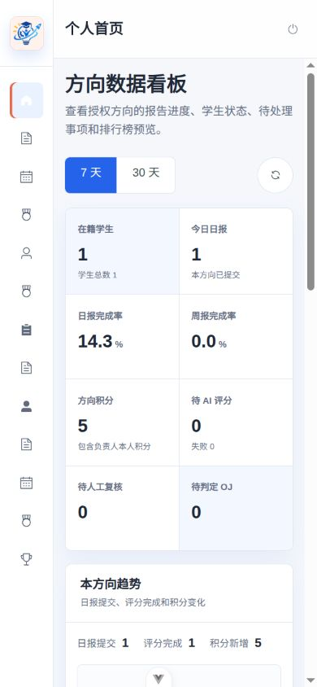

# 2026-10-13 前后端真实联调与发布前验证

## 1. 验证基线

- 后端仓库：`/home/dream/Projects/innovation-space-management`
- 后端分支：`refactor/layered-service-impl`
- 后端基线提交：`3429c97`
- 前端仓库：`/home/dream/Public/innovation-space-management`
- 前端分支：`frontend`
- 前端验证时基线：`f3cebe5`
- 后端：Java 21、Spring Boot、MySQL 8.0、Maven Wrapper
- 前端：Vue 3、TypeScript、Vite、Vitest、pnpm
- 真实接口模式：`VITE_USE_MOCK=false`
- 联调地址：`http://127.0.0.1:5174`，经 Vite 代理访问 `http://127.0.0.1:8080`

本轮使用独立的本地 MySQL 集成库和虚构账号。仓库、报告和日志不含真实账号、密码、Token、数据库备份或 API Key。

## 2. 自动化验证

| 检查 | 结果 |
| --- | --- |
| `pnpm install --frozen-lockfile` | 通过 |
| `pnpm test` | 19 个测试文件、69 个测试全部通过 |
| `pnpm type-check` | 通过 |
| `pnpm lint` | 通过 |
| `pnpm build` | 通过 |
| `backend/mvnw test` | 52 个单元测试全部通过 |
| `backend/mvnw clean verify` | 重构基线已通过 50 个单元测试和 106 个集成测试；本轮新增修复继续通过完整单元测试与定向集成测试，最终发布前仍需再运行一次完整 `clean verify` |

前端生产构建只有一个非阻断警告：主入口 chunk 超过 500 kB。功能不受影响，后续可单独进行路由/组件代码分割优化。

## 3. 真实接口结果

| 场景 | 请求 | 结果 |
| --- | --- | --- |
| 健康检查 | `GET /actuator/health` | `200` |
| 三种角色登录 | `POST /api/v1/auth/login` | `200 / 200 / 200` |
| 刷新令牌 | `POST /api/v1/auth/refresh` | `200` |
| 管理员看板 | `GET /api/v1/dashboard/admin?range=30d` | `200` |
| 负责人看板 | `GET /api/v1/dashboard/leader?range=7d` | `200` |
| 学生看板 | `GET /api/v1/dashboard/student?range=7d` | `200` |
| 非法时间范围 | `GET /api/v1/dashboard/student?range=14d` | `400` |
| 管理员人员列表 | `GET /api/v1/members?page=1&size=20` | `200` |
| 学生越权人员列表 | `GET /api/v1/members?page=1&size=20` | `403` |
| 负责人个人排名 | `GET /api/v1/rankings/me` | `403` |
| 学生个人排名 | `GET /api/v1/rankings/me` | `200` |
| 总榜/方向榜 | `GET /api/v1/rankings/...` | `200 / 200` |
| 创建日报 | `POST /api/v1/daily-reports` | `201` |
| 修改日报 | `PATCH /api/v1/daily-reports/{id}` | `200` |
| 提交日报 | `POST /api/v1/daily-reports/{id}/submit` | `200` |
| 当天重复创建 | `POST /api/v1/daily-reports` | `409 REPORT_ALREADY_EXISTS` |
| 重复提交当前版本 | `POST /api/v1/daily-reports/{id}/submit` | `200`，幂等返回现状 |
| 管理员直接加分 | `POST /api/v1/members/{id}/points` | `200` |
| 积分流水 | `GET /api/v1/points/me` | `200` |

日报最小请求体已验证：

```json
{
  "learningContent": "联调：学习 Spring Boot 分层架构"
}
```

服务端自动生成 `reportDate=2026-10-13`，省略的 `gains` 为空字符串、`problems` 为 `null`。正式提交后 Mock Provider 异步评分成功，最终 3 分，报告状态为 `SUBMITTED / SCORED`。

管理员直接加分已与报告评分同时验证：人工积分不会被错误纳入报告评分差额计算，最终积分流水可正确汇总。

## 4. 浏览器验证

- 管理员登录后进入管理数据看板，30 天默认范围、人员/报告/评分/OJ/待办/方向对比正常。
- 负责人登录后进入方向数据看板，7 天默认范围，学生状态和方向排行榜正常，不显示负责人个人排名。
- 学生登录后进入个人数据看板，积分、排名、日报状态、积分流水和报告摘要正常。
- 页面刷新后回到登录页。这是当前内存 Token 契约的预期行为，不按“记住登录”处理。
- 日报表单只显示：学习内容（必填）、收获（选填）、遇到的问题（选填）。
- 只填写学习内容即可保存草稿并正式提交，真实接口完成创建、保底积分和异步评分。
- “我的日报 / 我的周报”已限定为当前成员，不再混入负责人所辖学生的报告。
- 390×844 移动端视口下看板无明显重叠或溢出。

移动端截图：



## 5. 本轮发现并修复的问题

1. 启用 `AI_PROVIDER=mock` 时错误要求外部模型名和 API Key。
2. 评分线程池把拒绝策略误传为线程工厂，后台评分任务永远无法执行。
3. 管理员人工加分流水的 `report_id` 为空时，会破坏后续报告评分计算。
4. 负责人“我的日报/周报”未按本人 `memberId` 过滤，混入所辖方向的正式报告。

以上均补充了 RED-GREEN 回归测试，并通过前端完整质量套件和后端定向/完整单元测试。

## 6. 发布前仍需项目负责人确认

- 生产域名、HTTPS 证书和反向代理入口。
- 学院管理员、方向负责人和学生账号的私密交付与首次改密流程。
- 数据库备份、恢复演练、保留周期和恢复目标。
- MySQL 8.0 已进入 EOL，需要确认继续使用期限或升级计划。
- 日报/周报最终 1–3 分规则以及 `REPORT_POINTS_MODE` 的正式取值。
- AI 厂商、模型、API Key、数据发送与保存策略。
- Judge0 部署、私有测试数据隔离和 GPL-3.0 合规审查。
- 首次正式部署前重新执行完整 `backend/mvnw clean verify` 和前端完整质量套件。
